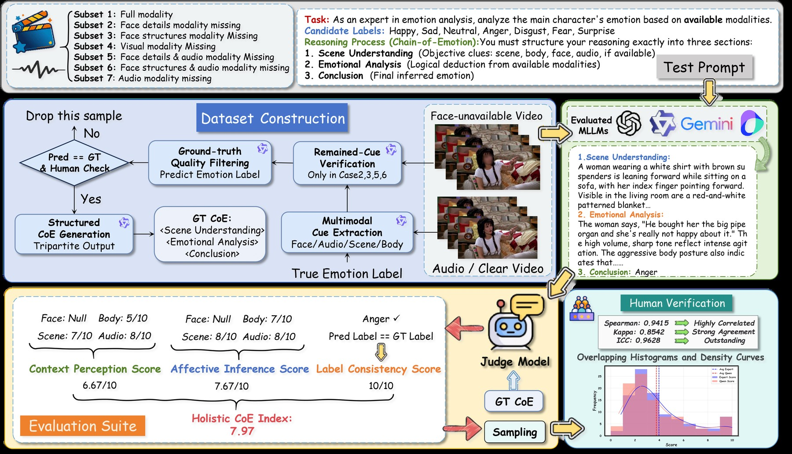

# MIME Benchmark

### Face Is Not All You Need: MIME Benchmark for Incomplete Multimodal Emotion Recognition

**Official repository of the ACM Multimedia 2026 (ACM MM '26) paper**

[](https://doi.org/10.1145/3767308.3838643) [](https://doi.org/10.1145/3767308.3838643) [](https://creativecommons.org/licenses/by/4.0/)

<!-- 等 arXiv 公告后，把下一行取消注释并替换 ID，即可显示 arXiv 徽章 -->
<!-- [](https://arxiv.org/abs/XXXX.XXXXX) -->

**MIME: A Chain-of-Emotion (CoE) benchmark for incomplete multimodal emotion recognition. It provides structured reasoning annotations to support robust and interpretable emotion understanding when facial, visual, or audio cues are partially unavailable.**

This repository contains the official introduction and code implementation for the paper "**Face Is Not All You Need: MIME Benchmark for Incomplete Multimodal Emotion Recognition**" (accepted to ACM Multimedia 2026).

<p align="center">
  <a href="https://yuxinokk.github.io/MIME/"><b>[HomePage]</b></a> |
  <a href="https://doi.org/10.1145/3767308.3838643"><b>[Paper]</b></a> |
  <a href="https://drive.google.com/drive/folders/1RgBzBK7UJMWL43hEPQzmZTJtSI7TkHhe?usp=sharing"><b>[Dataset]</b></a> |
  <a href="./license.pdf"><b>[License]</b></a> |
  <a href="./supplementary_material.pdf"><b>[Appendix]</b></a>
</p>

<p align="center">
  
</p>

<p align="center"><sub><b>Overview of MIME.</b> <b>Top:</b> the seven incomplete-modality subsets and the three-part Chain-of-Emotion (CoE) prompt. <b>Middle:</b> the dataset construction pipeline, where samples passing ground-truth quality filtering go through multimodal cue extraction and remained-cue verification before the structured CoE generation. <b>Bottom:</b> the evaluation suite, which aggregates Context Perception (CPS), Affective Inference (AIS) and Label Consistency (LCS) into a Holistic CoE Index, validated against human judgments.</sub></p>

---

## News
* **[2026.11]** MIME is accepted to **ACM Multimedia 2026 (ACM MM '26)**. Paper: [10.1145/3767308.3838643](https://doi.org/10.1145/3767308.3838643).
* **[2026.04]** The MIME benchmark repository is created for ACM Multimedia 2026. Mini data and code will be updated continuously.

## About MIME

Real-world multimodal emotion recognition frequently encounters incomplete or compromised observations, such as natural occlusion, side or back-facing heads, low-resolution capture, blurred facial regions, or missing audio. Existing datasets, however, largely assume full-modality availability and provide only emotion labels. This makes it difficult to study how models infer emotions when key cues are degraded or absent.

To bridge this gap, we introduce a dedicated **Chain-of-Emotion (CoE)** benchmark for incomplete multimodal emotion recognition.

**Key Features:**
- **Seven incomplete-modality subsets:** MIME includes one full-modality subset and six incomplete subsets that cover mild facial degradation, severe facial degradation, visual missingness, audio missingness, and dual-modality loss.
- **Natural plus controlled incompleteness:** The benchmark combines naturally challenging source videos with controlled degradation, allowing both realism and clear subset-based analysis.
- **Structured reasoning (CoE):** Each sample contains a three-part reasoning chain: Scene Understanding, Emotional Analysis, and Conclusion.
- **Rigorous evaluation:** The benchmark keeps seven emotion categories balanced while preserving uneven case sizes to reflect real scenario diversity.

## Repository Structure
- `data/`: Seven subset folders containing the video files. Each subset corresponds to a distinct incomplete-observation scenario:
  - **`Subset1_FM` (Full Modality):** Intact audio-visual clips with complete observations.
  - **`Subset2_FDM` (Mild Facial Degradation):** Light facial-region blur that weakens subtle facial details while preserving coarse layout.
  - **`Subset3_FSM` (Severe Facial Degradation):** Strong facial-region blur that substantially removes usable facial structure, forcing reliance on body, scene, and audio cues.
  - **`Subset4_VMM` (Visual Modality Missing):** Audio-only setting with visual frames removed.
  - **`Subset5_FDAM` (Mild Facial Degradation + Audio Missing):** Light facial degradation combined with removed audio.
  - **`Subset6_FSAM` (Severe Facial Degradation + Audio Missing):** Strong facial degradation combined with removed audio, creating the most challenging visual-only residual setting.
  - **`Subset7_AMM` (Audio Modality Missing):** Visual-only setting with audio removed.
- `data_list.txt`: Index of released sample files and metadata.
- `eval/`: Evaluation and testing scripts.
  - `predictcoe_evalacc.py`: Generates predicted emotion labels and CoE outputs, then computes hard metrics such as accuracy across subsets.
  - `eval_coe.py`: Uses an LLM-as-a-Judge protocol to evaluate the quality of model-generated CoE reasoning.
- `label.jsonl`: Structured CoE annotations for released samples.
- `natural_degradation/`: Qualitative clips that illustrate naturally occurring degradation already present in source videos before any controlled corruption is applied. This directory is provided for rebuttal clarification and qualitative inspection only; it is **not** an additional benchmark subset.
  - `foreground_or_object_occlusion/`: 108 clips with foreground people, scene objects, or structures partially blocking the target face or body.
  - `side_facing_or_turning_away/`: 59 clips with clear side-facing poses, head turning, or incomplete frontal visibility.
  - `low_light_or_low_visibility/`: 21 clips with dark lighting, poor visibility, or severe underexposure.
  - `hand_or_body_occlusion/`: 5 clips with hands, arms, or body parts covering important facial cues.
  - `natural_degradation.csv`: Per-clip index for the released videos, including the English folder assignment together with the original Chinese tags and notes.
- `assets/`: Figures used in this README.
- `README.md`: This file.
- `license.pdf`: License document for benchmark access and usage.
- `supplementary_material.pdf`: Appendix and supplementary materials.

## Natural Degradation
To make the source-video realism more transparent, we additionally release a small qualitative collection in `natural_degradation/`. These clips are grouped by their **primary naturally occurring degradation pattern** observed in the original videos, before any benchmark-side corruption is added.

This release is intended to support readers and reviewers who want concrete examples of the kinds of real-world imperfections already present in MIME source data. Some clips may exhibit multiple challenging factors at once, but each clip is placed into one folder according to its dominant visible characteristic.

## Evaluation
We provide tools in the `eval/` directory to assess both classification performance and reasoning quality:

* **Hard Metrics Evaluation (`predictcoe_evalacc.py`):** This script runs models on audio-video inputs, obtains predicted emotion categories together with generated Chain-of-Emotion outputs, and computes hard metrics such as classification accuracy across different subsets.
* **CoE Quality Evaluation (`eval_coe.py`):** This script adopts an LLM-as-a-Judge protocol to evaluate generated Chain-of-Emotion outputs against ground-truth reasoning structures.
* **Robustness Checks:** In our rebuttal-stage analysis, we further verify evaluation stability with an independent Gemini judge, prompt sensitivity tests across three prompt variants, and HCI sensitivity analysis under different metric weights.

## Availability
The benchmark can be accessed in two ways. To quickly preview it, you can directly download a small sample set containing 4 videos per subset (28 videos in total). To use the full benchmark, please sign `license.pdf` and send it to `jinj62062@gmail.com` (CC: `lanx@cse.neu.edu.cn`).

## Citation

If you find MIME useful in your research, please cite our paper:

```bibtex
@inproceedings{jia2026mime,
  author    = {Jia, Yuxin and Lan, Xing and Wang, Wensong and Xue, Jian and Ren, Feiliang and Lu, Ke},
  title     = {Face Is Not All You Need: MIME Benchmark for Incomplete Multimodal Emotion Recognition},
  year      = {2026},
  isbn      = {9798400722134},
  publisher = {Association for Computing Machinery},
  address   = {New York, NY, USA},
  url       = {https://doi.org/10.1145/3767308.3838643},
  doi       = {10.1145/3767308.3838643},
  booktitle = {Proceedings of the 34th ACM International Conference on Multimedia},
  pages     = {16784--16791},
  numpages  = {8},
  keywords  = {incomplete multimodal emotion recognition, multimodal large language models, benchmark, chain of emotion, emotion recognition},
  location  = {Rio de Janeiro, Brazil},
  series    = {MM '26}
}
```

## License
The benchmark and code in this repository are released under the Creative Commons Attribution 4.0 International (CC BY 4.0) license. See `license.pdf` for the uploaded license document.

